  

### Things I've Built

| Project | What it does | Focus |
| :--- | :--- | :--- |
| **ENBD X** | Mobile banking app for Emirates NBD (Card Services) | Fintech · Banking |
| **PayNearby App 2.0** | Kotlin-first greenfield rewrite, MVVM + Clean Architecture | Fintech · Payments |
| **100MB** | Sachin Tendulkar's fan app — content feeds, live quizzes, rewards | Entertainment · OTT |
| **Blue Planet** | Sony OTT platform for UK market with DRM + offline downloads | Streaming · DRM |
| **Sugarbox** | Offline-first OTT platform streaming from local edge servers | Edge Computing |
| **RPL SDK** | Gamified retailer engagement SDK inspired by IPL mechanics | Engagement · SDK |

  <a href="https://www.linkedin.com/in/ravi-rajak-8bb078a4/">LinkedIn</a> &nbsp;·&nbsp;
  <a href="https://github.com/ravirajjak">GitHub</a> &nbsp;·&nbsp;
  <a href="mailto:ravirajjak@gmail.com">Email</a>

Curious by default. Building with intent.

